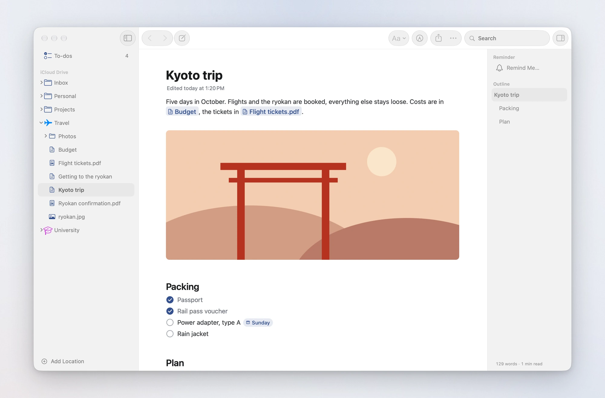
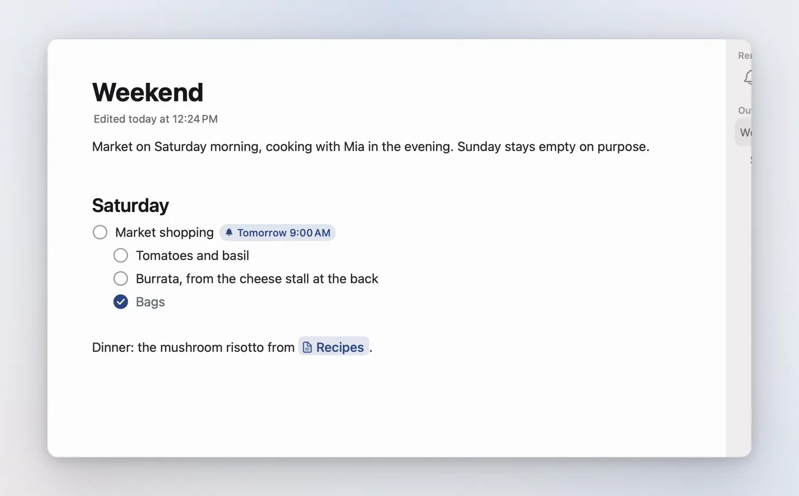
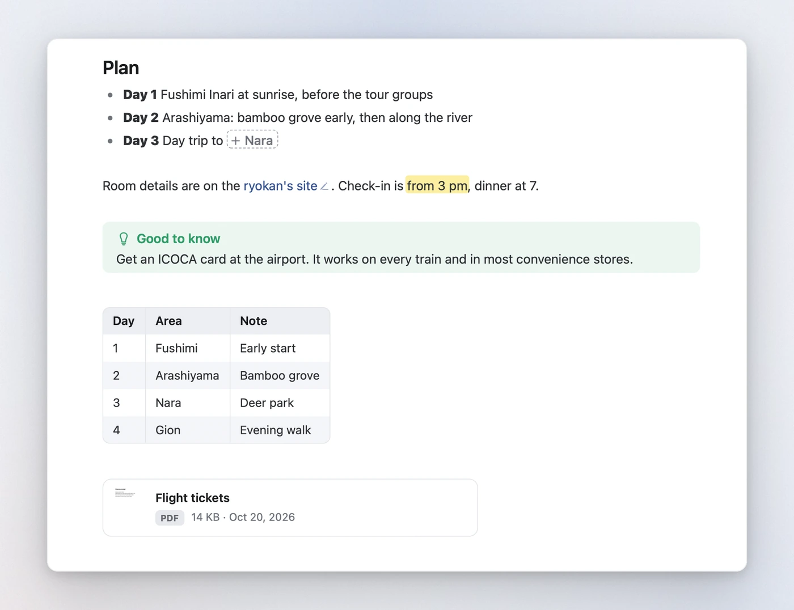
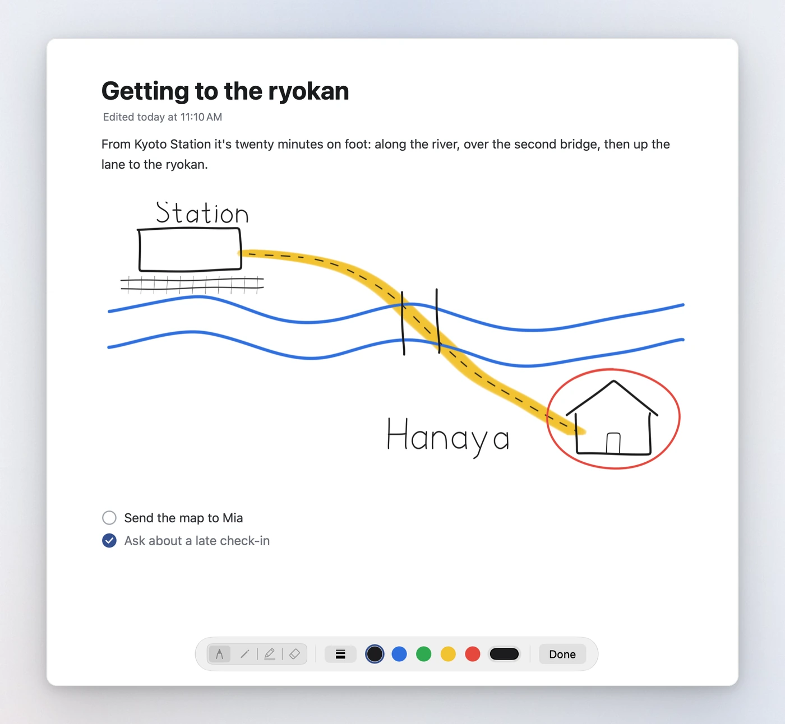
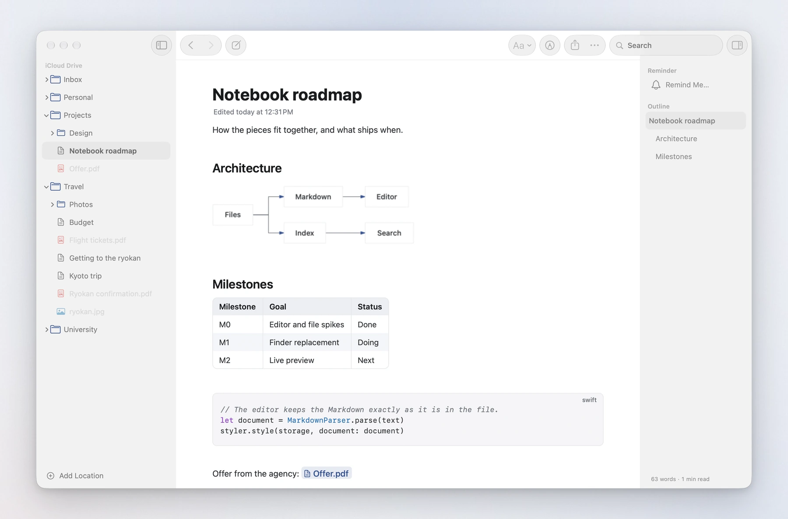
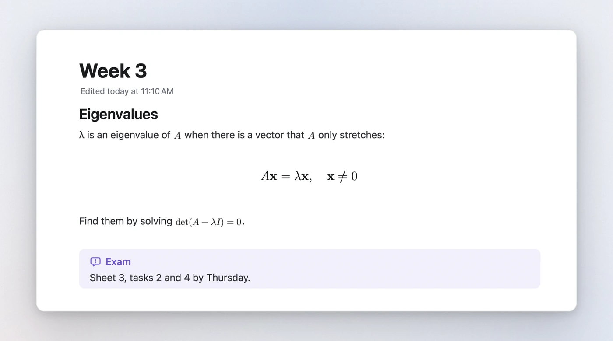
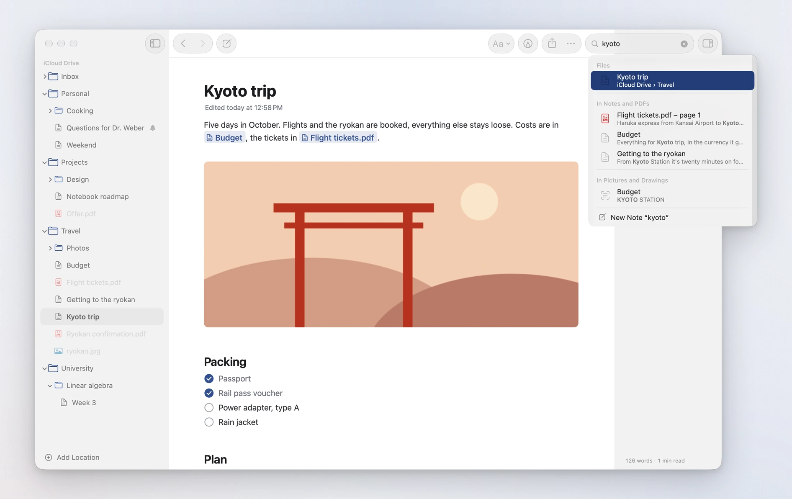
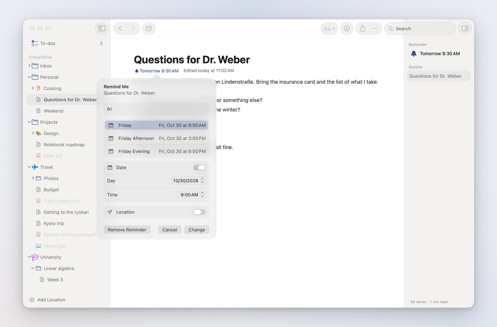
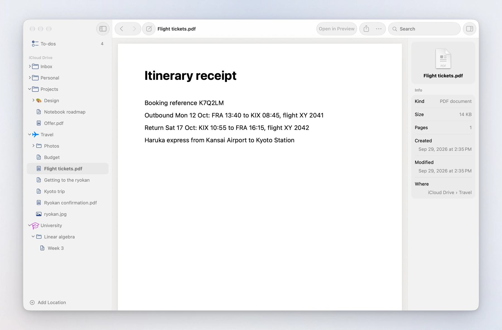
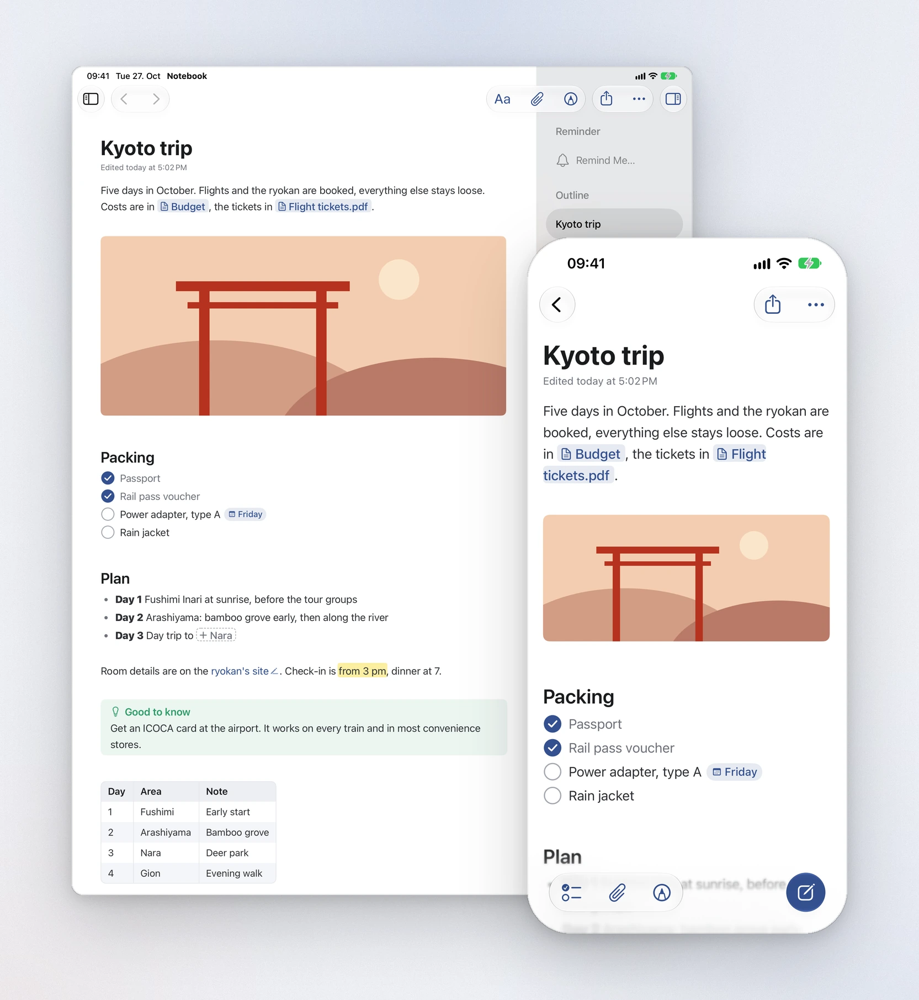

<p align="center">
  
</p>

<h1 align="center">Notebook</h1>

<p align="center">
  <b>Markdown notes for Mac, iPhone and iPad that write like Apple Notes</b>, kept as plain files in your own folders.<br>
  No database, no import and no sync of its own: iCloud Drive, or any folder you choose, is the library.
</p>

<p align="center">
  
  
  
  
  <a href="LICENSE"></a>
  <a href="CHANGELOG.md"></a>
</p>

<p align="center">
  <a href="#a-quick-tour"><b>Tour</b></a> &nbsp;·&nbsp;
  <a href="#how-notes-are-stored"><b>File format</b></a> &nbsp;·&nbsp;
  <a href="#getting-started"><b>Getting started</b></a> &nbsp;·&nbsp;
  <a href="#using-it"><b>Shortcuts</b></a> &nbsp;·&nbsp;
  <a href="CHANGELOG.md"><b>Changelog</b></a> &nbsp;·&nbsp;
  <a href="https://lukaskaibel.github.io/notebook/"><b>Website</b></a>
</p>

<br>

<picture>
  <source media="(prefers-color-scheme: dark)" srcset="Design/screenshots/hero-dark.webp">
  
</picture>

> **Status: early.** Version 0.1.0 runs on the Mac, iPhone and iPad, and you build it from source (five minutes, see
> below). It already covers writing, organising and finding notes day to day. Quick capture and the App Store come
> later; see [Not there yet](#not-there-yet).

## Why

Apple Notes is a pleasure to write in, but it keeps your notes in its own database. Markdown apps keep them as files,
but most of them feel like a code editor or ask you to move everything into a vault. Notebook does both: it shows the
folders you already have, iCloud Drive first, and turns the Markdown files in them into notes that write like Notes.
Pictures, PDFs and every other file sit right next to them and open in the window: PDFs and pictures as in Preview,
videos as in QuickTime Player, the rest in Quick Look. What Notebook saves is ordinary Markdown that GitHub, Obsidian or
iA Writer read just the same, and with iCloud Drive the same notes are on your Mac, iPhone and iPad.

## A quick tour

### Markdown that gets out of the way

You write Markdown, and Notebook shows the result as you type. On the Mac, and on an iPad or iPhone with a keyboard,
the marks show faintly next to the caret, only for the bit you're on, so the arrow keys reach them and Delete takes
them; they unfold as the caret comes and fold away as you move on, and the text beside them slides along instead of
jumping. On the touch keyboard they stay hidden, and the bar above it shows the styles the caret is in. A heading's `#`s
show the same way, and while the caret is on one its level sits in the margin; a click there turns it into a title,
heading, subheading or body text, each shown as it looks in the note, as in the toolbar's Aa menu. Lists continue on
Return, Tab nests them, and checkboxes tick with a click.

Typing goes as in Notion or Bear. ⌘B inside bold text takes the bold off, and a second press puts it back; at the end
of bold text it steps out, so you type on plainly. Return there goes to the next line without the `**`. Marks go in
pairs: deleting a star takes one from the other end too, so bold becomes italics and then plain text, and typing a star
there brings them back the same way; on the touch keyboard, where the stars don't show, Delete takes the letter you see
and the bold stays. Typing `**` brings the closing `**` along, with the caret between them; type the closing stars
yourself and they are stepped over. `-` at the start of a line makes a bullet, `-[]` a checkbox, and `##` gets its space
whether you type text after it or in front of a line's text, since two `#`s only ever start a heading (one may be a
tag). Return on a heading without text takes the heading
off, and at the start of one puts a line above it. The text eases into its new look as you type: bold thickens, a
heading grows, the marks fade in.

The title of a new note has the caret first. Return, Tab, ↓, or → at its end go on into the text, and ↑, ←, or Delete at
the very start of the text go back up into the title, on the Mac and on an iPad or iPhone with a keyboard alike.

<picture>
  <source media="(prefers-color-scheme: dark)" srcset="Design/screenshots/typing-dark.webp">
  
</picture>

Nothing moves while you select text or hold the mouse button, so a selection never jumps. Long notes type and scroll
without a stutter.

### Pictures, links and files are objects

Pictures, `[[links]]` to other notes and files you drop in behave as in Notes: the caret steps over them, Backspace
removes one whole, and their Markdown never shows. Type `[[` for suggestions; a link to a note that doesn't exist yet
is drawn dashed and creates the note with a click. Web links show their text with a small pencil that edits the
address. A PDF or any other file on a line of its own becomes a card with a preview, and Space opens it in Quick Look.

<picture>
  <source media="(prefers-color-scheme: dark)" srcset="Design/screenshots/objects-dark.webp">
  
</picture>

Paste or drop a picture and it's saved next to the note, in a hidden `.assets` folder, as PNG or JPEG so that other
apps can show it. Delete it from the note and the file goes to the Trash once you leave the note, unless another note
in the folder still uses it. Move a note to another folder and its pictures move along.

### Drawings

Click the pencil in the toolbar and draw right in the note, as in Notes. Drawing starts where you are, and the note
doesn't move: in the drawing on screen, or in a new one below the line you're writing on, at the end of the note when
it's on screen, or else below the line in the middle of the screen. A new drawing is as wide as the text and grows as
you draw near its lower edge, so you can keep going down. As in Notes, there's no frame around it: you draw in the space
between the lines of text, and at the end of the note anywhere below the text. Text stays text: you draw in the
drawings, never over the words. On iPhone and iPad it is PencilKit with Apple's own tool picker, so Apple Pencil with
its pressure and tilt, the ruler and the lasso work as they do in Notes; one finger draws and two scroll, or, where only
Apple Pencil draws, a finger scrolls. On the iPhone, Undo is in the bar at the top while you draw, as in Notes; touch
and hold it for Redo. On the Mac you draw with the mouse, the trackpad or a tablet's pen, with a pen, pencil, marker or
eraser from a palette at the bottom of the note. Done, Escape or a click in the text puts the drawing back in the text,
as tall as what you drew; start typing and the text goes on below it. Tap a drawing (double-click it on the Mac) to draw
in it again.

<picture>
  <source media="(prefers-color-scheme: dark)" srcset="Design/screenshots/drawing-dark.webp">
  
</picture>

Each drawing is a PNG in `.assets`, which every Markdown app shows, with white behind the ink so it reads in dark
mode too. Next to it, a `.drawing` file keeps the strokes, so you can go on drawing in it later, on any of your
devices; the picture is made again from them a moment after every stroke.

### Tables, diagrams, code and maths

Tables are drawn as tables, Mermaid diagrams as diagrams (natively, without a web view), code with highlighting for
about forty languages, and LaTeX maths as typeset formulas. Click into one and its source appears, with a live
preview for diagrams and formulas. Point at a code block and a button in its corner copies the code. Callouts in
GitHub's and Obsidian's `> [!note]` style get their colour and symbol.

<picture>
  <source media="(prefers-color-scheme: dark)" srcset="Design/screenshots/blocks-dark.webp">
  
</picture>

<picture>
  <source media="(prefers-color-scheme: dark)" srcset="Design/screenshots/math-dark.webp">
  
</picture>

### Find anything

The search field in the toolbar (⌘F) finds notes, files and folders by name, the headings in notes, and words in notes
and PDFs, with the page they're on. It also reads the words in pictures, in scanned PDFs and in the handwriting of
drawings, so a photographed receipt or a scanned letter turns up too. Type several words in any order; notes that have
them together come first. A result opens where it was found: the note scrolled to the words with them selected (they
bounce as Find does in Safari), a PDF at its page, a heading, or the picture in a note. Return opens the first match,
and the last suggestion is always a new note with what you typed as its name. With an empty field, it lists what you
opened last.

Search runs in the background on every core, a few milliseconds a letter even in a whole iCloud Drive, so typing never
waits for it; the results stay until the new ones are there. Notebook keeps what it has read between launches, so search
finds everything the moment it opens, and then reads only the notes and PDFs that changed since; the very first time,
while it is still reading your files, it finds what it has read so far. Pictures, scans and drawings are read on your
Mac, iPhone or iPad with Apple's own text recognition, in the background and once each; Settings › General › Search
turns it off.

<picture>
  <source media="(prefers-color-scheme: dark)" srcset="Design/screenshots/search-dark.webp">
  
</picture>

### Everything with ⌘K

⌘K opens a field over the window, as Spotlight does. It finds everything search finds, and runs what the menus do:
for the note that is open (rename it, move it, duplicate it, set a reminder, draw, export, print, move it to the
Trash), the text styles, a new note or folder, back and forward, the sidebar and outline, the text size, the typeface,
and Settings, each with the keys that do it without ⌘K. Type a few letters of a command, or `>` first to see only
commands. Move To… lists the folders as you type their names. The arrow keys and Return pick, Escape closes. On an iPad
with a keyboard, ⌘K works the same.

### Remind me of a note

Questions for the doctor, points for a meeting: Remind Me… brings a note back at the time you choose. Pick Later
Today, This Evening or Tomorrow, or a date and a time, in a popover like a reminder's details in Reminders. The note
then shows a bell and the time under its title ("Tomorrow 8:30") and a bell in its row; a click on it changes the time
or removes the reminder, and once the time has passed it turns red. At that time a notification comes with the note's
name, the time and its first points: what is still to do first, then the rest, without pictures or front matter. It is
Time Sensitive, so it gets through a Focus. Tap it to open the note, or choose Remind Me in 1 Hour or Done.

On the Mac, Remind Me… is in the note's ⋯ menu, the sidebar's right-click menu and the inspector; on iPhone and iPad it
is in the ⋯ menu, on touch and hold, and, once you add it in Settings › Writing Bar, as a bell above the keyboard. The
reminder isn't written into the note, so the file stays as it was and the time doesn't go along when you share it.

<picture>
  <source media="(prefers-color-scheme: dark)" srcset="Design/screenshots/reminder-dark.webp">
  
</picture>

### PDFs, pictures and every other file

Notebook is a browser for your folders, not only for notes. A PDF opens right in the window the way Preview shows it, its
pages one under the other: there at once, and back where you left it when you return. A picture fits the window on the
same grey, never larger than it is; pinch or double-click to zoom in on a spot. A video plays with the system's
controls, as in QuickTime Player. A spreadsheet or any other file opens in Quick Look. The inspector shows a file's
details, and "Open in" hands it to its own app.

<picture>
  <source media="(prefers-color-scheme: dark)" srcset="Design/screenshots/quicklook-dark.webp">
  
</picture>

### A Mac app, made of the Mac's parts

The window is built from the system's own pieces: a source-list sidebar, a toolbar with the system's search field and
share menu, an inspector, Settings, alerts, PDFKit, AVKit and Quick Look. It follows the system's light or dark
appearance. The inspector shows a note's outline, with the section you're reading marked and a word count; a click on
a heading scrolls there. In Settings › Text you pick the typeface (San Francisco, New York, Rounded or Monospaced,
each shown in itself), the size, the line spacing and the line width. The icon is a leather notebook, and Settings › App Icon makes it yours:
pick the leather, the elastic band, the ribbon and the background, and the Dock shows your notebook while the app is
open. Links, the caret and folders are in ink blue to go with it, or in the accent colour you chose in System Settings.

### On iPhone and iPad

The same notes in the same editor, laid out the way each device works. On the iPhone you go into one folder per screen,
as in the Files app, and a note opens on a screen of its own; swipe from the edge to go back. The first screen has your
favourites, what you opened last and the folders of each location. New Folder, search and a new note sit at the bottom,
as in Notes, and search finds everything it finds on the Mac. While you write, a bar floats above the keyboard with
Aa, a checklist, attachments, a link, undo and the formatting, a page of tools at a time. On its left, buttons for
where the caret is come and go: the style you are in, tinted, to take it off with a tap, the line's checkbox, moving a
list item in or out, and opening the link you are on. Which tools and in what order is yours to choose: touch and hold
the bar, or tap the sliders after its last tool, or go to Settings › Writing Bar. Aa brings up the Format panel in the
keyboard's place, as in Notes: the text styles, bold, italic and the rest, lists, indenting and quotes. Pictures come
from the camera, the document scanner, your photos or the Files app. The pencil, at the bottom of the screen or in the
bar, draws in the note with Apple's tool picker. Tap a checkbox to tick it, a link to
follow it, a picture to look at it, a drawing to draw in it; touch and hold a picture and drag it to move it in the
note, or let go to copy, share or delete it. Swipe a file to move or delete it, or to make it a favourite; touch and
hold it for everything else.

The iPad has the Mac's layout: the sidebar with its folders opening in place, the note next to it, and the outline in
an inspector. In portrait the sidebar steps aside once you have picked a note. With a keyboard, the Mac's shortcuts
work, the menu bar has New Note, Go and Format, and the marks show next to the caret as on the Mac. Drag pictures from Photos into a note, or files onto a folder in
the sidebar. A window as narrow as a phone gets the iPhone's screens.

<picture>
  <source media="(prefers-color-scheme: dark)" srcset="Design/screenshots/devices-dark.webp">
  
</picture>

## What it does

- **Notes are files.** The title is the file name: rename a note by editing its title, and links to it in other notes
  follow. New notes go into the folder you're in.
- **Folders as they are.** Add iCloud Drive or any folder as a location with Add Location at the bottom of the
  sidebar, or drop the folder from the Finder below the sidebar's sections. iCloud Drive shows what the Finder shows
  in it: Desktop and Documents when they are kept in iCloud, and the folders of apps such as Pages or Obsidian.
  Folders are read and changes to files written in the background, so even a large iCloud Drive shows at once and
  nothing waits for it. Create, rename, duplicate and move notes and folders, by drag and drop or with Move To;
  Option-drag copies. The New Folder button next to a location's name makes a folder at its top, New Folder in a
  folder's menu one inside it, named in place as in the Finder. Deleting moves to the Trash, never further, and Undo
  (⌘Z) puts it back, as it takes back a rename, a move or a new file. Favourites sit at the top of the sidebar.
- **iPhone and iPad.** The same editor, search and file handling, with screens made for each: one folder per screen
  on the iPhone, the sidebar on the iPad. Pick iCloud Drive or any folder in the Files app's picker, or keep notes on
  the device, in On My iPhone › Notebook. A bar above the keyboard, whose tools you choose, formats, links and adds
  photos, scans and files, with buttons for where the caret is on its left; Aa opens the Format panel as in Notes.
  Deleting moves to Recently Deleted; where a place has none, Notebook asks before it deletes, and Undo (⌘Z) still
  brings it back while Notebook is open.
- **Hidden folders.** Right-click a folder you don't want to see, such as one another app keeps in iCloud Drive, and
  choose Hide Folder, or on iPhone and iPad touch and hold it. It leaves the sidebar, search and Move To, and stays
  hidden on your other Macs, iPhones and iPads through iCloud. The eye next to the location's name, or ⇧⌘., shows
  hidden folders again, dimmed, until you click it again; on iPhone and iPad, Show Hidden Folders is in the ⋯ menu.
- **Reminders.** Remind Me… brings a note back at a time you choose, with a notification of its first points that
  gets through a Focus. The reminder follows the note when you rename or move it in Notebook, goes when you delete it,
  and reaches your other Macs, iPhones and iPads through iCloud; each device shows the notification itself.
- **Live preview editor.** Headings, bold, italic, strikethrough, `==highlight==`, inline code, links, checklists,
  bulleted and numbered lists, quotes, callouts, tables, code blocks, maths, Mermaid, footnotes and front matter, which
  folds into a small "properties" pill. Styles turn on and off where the caret is, their marks come and go as a pair,
  and the text eases into each new look. With a keyboard the marks next to the caret unfold and fold away; on the touch
  keyboard they stay hidden.
- **Pictures and files in notes.** Paste or drop them in; `![[embeds]]` of other notes show an excerpt, of files a
  card with a preview.
- **Drawings in notes,** with PencilKit: Apple Pencil, a finger, the mouse, the trackpad or a tablet. Each is a PNG
  that other apps show, with its strokes kept next to it so it stays a drawing in Notebook.
- **PDFs, pictures, videos and other files** open in the window: PDFs and pictures as in Preview, videos as in
  QuickTime Player, the rest in Quick Look.
- **Search** for the names of notes, files and folders, headings, words in notes and PDFs, and the text in pictures,
  scans and handwriting, in the background as you type. ⌘K finds the same and runs commands.
- **Saves as you type,** and never overwrites a change made somewhere else (see below).
- **Export** a note as a PDF or a PNG image, or print it (on iPhone and iPad: as a PDF to share, or print).
- **Single files.** Open any Markdown file from the Finder or with ⌘O, and it gets a plain window of its own.

## How notes are stored

Everything is plain Markdown, so other apps keep reading your notes. Notebook adds no files of its own besides the
`.assets` folders for pictures and files you add to notes, and in them, next to each drawing's picture, a `.drawing`
file with its strokes. What isn't part of a note, such as the folders you hide and the reminders you set, is kept in
the app's settings and iCloud's key-value store, not in your folders. What search knows, the text of your notes and
PDFs and the words read in pictures, is kept in the app's caches on each device, from where it can always be read again.

| What | In the file | In Notebook |
| --- | --- | --- |
| Title | The file name, `Weekend.md` | A large title above the text; editing it renames the file |
| Picture | `` | The picture, fitted to the width |
| Drawing | ``, with `Weekend drawing 2026-10-16 at 10.20.15.drawing` next to the picture | The drawing, as wide as the text, to draw in again |
| Link to a note or file | `[[Recipes]]`, `[[Recipes\|text]]`, `[[Offer.pdf]]` | A link you click; dashed when the target doesn't exist yet |
| Embed | `![[Recipes]]`, `![[Offer.pdf]]` | An excerpt of the note, or a card for the file |
| Web link | `[text](https://…)` | The text, with a pencil to edit the address |
| Checklist | `- [ ]`, `- [x]` | A round checkbox, filled when done; done items turn grey |
| Highlight | `==text==` | A yellow highlight |
| Callout | `> [!tip] Title` | A coloured box with a symbol |
| Maths | `$x^2$`, `$$ … $$` | A typeset formula |
| Diagram | ```` ```mermaid ```` | The diagram |
| Front matter | `---` YAML `---` at the start | A small pill; click to see the YAML |

`[[Name]]` finds the note by its name, ignoring case and accents: one in the same folder first, then the one with the
shortest path. `[[Folder/Name]]` says exactly which. Remote pictures (``) are not downloaded; Notebook
shows their address instead.

## When a note changes somewhere else

Notes are often open on more than one Mac, or in more than one app. Notebook watches the open note and the folders in the
sidebar. If a note changes elsewhere while you haven't typed, it reloads quietly, and your caret and scroll position
stay where they were. If both sides changed, Notebook merges the two line by line, before every save as well, so it never
writes over a change it hasn't seen. Only when both changed the same lines does it ask: keep this version, use the
other one, or keep both as two files. Conflicts that iCloud Drive reports are handled the same way.

Notes in iCloud Drive that aren't downloaded yet are fetched so that search finds them; other files that live only in
iCloud show a cloud in the sidebar and download when you open them. A note that isn't on your Mac, iPhone or iPad yet
opens at once with its title, and its text follows when iCloud has brought it down, with "Downloading from iCloud…" if
that takes a moment. Until then nothing can be typed into it, so nothing is saved over the note in iCloud.

## Getting started

### Requirements

- A Mac with Apple silicon and macOS 27 or later
- An iPhone or iPad with iOS or iPadOS 27 or later, or the Simulator
- Xcode 27 or later, to build it

### Build and run

```bash
git clone https://github.com/lukaskaibel/notebook.git
```

```bash
open notebook/Notebook.xcodeproj
```

Choose the **Notebook** scheme, then **My Mac** or an iPhone or iPad simulator as the destination, and press ⌘R. A local
build needs no Apple developer account: without a team, Xcode signs it to run on your Mac and in the Simulator. To run
it on your own iPhone or iPad, or to sign with your own team, create `Config/Local.xcconfig` with `DEVELOPMENT_TEAM =
<your team ID>`; it isn't checked in. A local build keeps hidden folders and reminders on the device; only the App
Store build, signed with a team, has the iCloud entitlement that takes them to your other devices, and the one for Time
Sensitive notifications.

### Adding your notes

On first launch, Notebook asks for a folder: **Open iCloud Drive**, or **Choose another folder…**. Add more later with
**Add Location** at the bottom of the sidebar, by dropping a folder on the sidebar or on Notebook in the Dock, or with
File › Open… (⌘O), File › Add Location… and Settings › General. Notebook works on the files in place; nothing is
copied or imported. A new location shows in the sidebar straight away, and its files a moment later, however many
there are.

On iPhone and iPad, **Choose a Folder** opens the Files app's picker: pick iCloud Drive itself to have everything you
write on the Mac, or any folder in it or on the device. **Keep Notes on This iPhone** (or iPad) uses Notebook's own
folder, which the Files app shows under On My iPhone › Notebook. Add more in Settings, from the ⋯ menu.

To look around without your own notes, run a Debug build with the arguments `-NotebookLibrary /tmp/NotebookSample
-NotebookDemo YES` (Product › Scheme › Edit Scheme › Arguments). It writes a few sample notes, pictures and PDFs to that
folder and shows only them, for that run. In the Simulator, use `-NotebookLibrary ~/Documents/Sample`, which is in the
app's own folder there.

## Using it

| Shortcut | Action |
| --- | --- |
| ⌘N | New note in the current folder |
| ⇧⌘N | New folder in the current folder, named in place |
| ⌘Z, ⇧⌘Z | Undo and redo: typing, and changes to files (the Trash, a rename, a move, a new note or folder), newest first |
| ⌘F | Search |
| ⌘K | Search and run commands; `>` for commands only |
| ⌘[ and ⌘], or swipe between pages | Back and forward; the swipe follows System Settings, as in Safari |
| ⌘O | Open a Markdown file in a window of its own, or a folder in the sidebar |
| ⌃⌘S | Show or hide the sidebar |
| ⌃⌘I | Show or hide the outline |
| ⇧⌘. | Show or hide hidden folders |
| ⌘+, ⌘− and ⌘0 | Bigger, smaller and actual text size |
| ⌥⌘E | Export as PDF |
| ⌘P | Print |
| ⌘, | Settings |

While writing:

| Shortcut | Action |
| --- | --- |
| ⌘B, ⌘I | Bold, italic; inside bold text it comes off (again: back on), at its end you step out of it |
| ⇧⌘X | Strikethrough |
| ⌃⌘H | Highlight |
| ⌘E | Inline code |
| ⌘L | Link: wraps the selection, or starts a `[[link]]` |
| ⇧⌘T, ⇧⌘H, ⇧⌘J, ⇧⌘B | Title, heading, subheading, body |
| ⇧⌘L | Checklist |
| ⇧⌘U | Mark as checked |
| ⇧⌘7, ⇧⌘9 | Bulleted list, numbered list |
| ⌘' | Block quote |
| Tab, ⇧Tab | Nest or un-nest a list item (in code: indent) |
| ⌥⌘] and ⌥⌘[ | Increase and decrease indent |
| `*`, `_`, `` ` ``, `~` or `=` with text selected | Wrap the selection in that mark |
| Return at the end of bold text | The next line, without the bold; in the middle of it, the bold goes on |
| Delete behind `**bold**` | A star from each end: italics, then plain text; `*` there brings them back (on the touch keyboard, where the stars don't show: the last letter) |
| `*` at either end of `*italics*` | One at the other end too: bold |
| `-` at the start of a line | A bullet; `-[]` a checkbox, `---` a rule |
| `##` and then text, or `##` in front of a line | The space a heading needs goes in for you |
| `**` (also `~~`, `==`) | The closing pair comes along, the caret between; a space next makes them plain stars |
| Return on a heading | At its start: a line above it; on one without text: back to body text |
| `[[` | Suggestions for a link; ↑↓ and Return or Tab to pick |
| Space on a selected picture | Quick Look |
| Double-click a drawing | Draw in it |
| Esc, or start typing | Stop drawing; typing goes on below the drawing |
| ↑ on the first line, ← or Delete at the very start | Into the title, at its end |
| Return, Tab, ↓, or → at the end of the title | Into the text |

In the sidebar: Return renames, ⌘⌫ moves to the Trash, and Space opens a file in Quick Look. Right-click a file or
folder for everything else, including New Folder, Copy Link, which copies a `[[link]]` to it, Remind Me… and Hide
Folder. As you point at a location's name, a folder with a plus comes up next to it for a new folder at its top, and,
when the location has hidden folders, an eye that shows them.

On an iPad with a keyboard, ⌘N, ⌘Z and ⇧⌘Z, ⌘F, ⌘K, ⌘[ and ⌘], ⌃⌘I, ⇧⌘. and the shortcuts for writing work as on the
Mac. On iPhone and iPad:

| Gesture | Action |
| --- | --- |
| Swipe from the left edge | Back to the folder or the note you came from (iPhone) |
| Swipe a file to the left or right | Move or delete it, add it to your favourites, or hide a folder |
| Touch and hold a file or folder | Set a reminder, rename, move, duplicate, copy a link, hide a folder, share and more |
| Pull a list down | Read the folder again |
| Tap a checkbox, a link or a picture | Tick it, follow it, or look at it in Quick Look |
| Tap a drawing | Draw in it |
| While drawing: one finger, two fingers | Draw, scroll (where only Apple Pencil draws, a finger scrolls) |
| While drawing on the iPhone: Undo at the top, or touch and hold it | Take back the last stroke, or Redo |
| Touch and hold a picture or file in a note, then drag | Move it to another place in the note, or into another app |
| Touch and hold a picture or file, then let go | Select it: Quick Look, copy, cut, share or delete |
| Tap the heading level in the margin | Title, heading, subheading or body, each as it looks (iPad) |
| Touch and hold the bar above the keyboard | Choose its tools and their order |
| Drag down over a note | Put the keyboard away |

## Not there yet

Planned, and not built yet:

- **Quick capture:** a widget, a control in Control Center and on the Lock Screen, the Action button and a share
  extension, all adding a note to an Inbox folder.
- **Spotlight:** notes don't turn up in Spotlight yet, only in Notebook's own search.
- **Reminders at a place** (arriving or leaving) **and when a calendar event starts,** and on the iPhone a Live
  Activity that keeps the note on the Lock Screen. A reminder set on another device reaches an iPhone or iPad the next
  time Notebook runs there or gets time in the background. Reminders don't repeat.
- Links follow a renamed note, but not yet a moved one, a renamed folder or a rename in a single-file window.
  Footnotes are styled but don't jump to their text.
- On iPhone and iPad there is no Settings › App Icon (iOS only switches between icons built into the app), no PNG
  export and no window of its own for a single file.
- **Sketches** as files of their own, next to your notes rather than in one.
- Translations: the app is in English only.

The full plan, with what is deliberately left out (tags, backlinks, a database, sync of its own), is in
[PLAN.md](PLAN.md), in German.

## For contributors

```
Notebook/                    The app target (Mac, iPhone and iPad): the entry point and the icon
NotebookUITests/             UI tests on an iPad simulator, for what only a real keyboard or touch reaches
Packages/NotebookKit/
  Sources/NotebookKit/
    Editor/                  The live-preview editor on TextKit 1: styling, hidden marks, objects, typing, export;
                             the Mac's text view, and iPhone's and iPad's in the "+UIKit" files
    Markdown/                Notebook's Markdown parser, which keeps every character's position in the file
    Render/                  Tables, maths, diagrams and code highlighting
    Drawing/                 Drawings: the strokes file and its picture, and drawing them in notes
    Files/                   Locations, the file tree read in the background, file operations, saving, watching, the
                             three-way merge, and the hidden folders and reminders kept in iCloud's key-value store
    Index/                   Search: the index of every file and how it is kept between launches, the corpus a
                             search goes through on every core, the text read in pictures, scans and drawings, and
                             how [[links]] resolve
    Platform/                The few names and calls that differ between AppKit and UIKit
    UI/                      The Mac's window, sidebar, inspector, search field, Settings and file windows; PDFs,
                             pictures, videos and Quick Look; what both share, such as the outline and search results
    UI/iOS/                  The iPhone's and iPad's screens: folders, the sidebar, the note, search and Settings
    Debug/                   The debug remotes and the sample notes (Debug builds only)
  Tests/                     Parser, editor, merge, smoothness, search index, drawing, reminder and app icon tests
Config/                      Build settings, Info.plist and entitlements
Design/                      The icon, the README pictures and the social preview
Website/                     The website, published to GitHub Pages by .github/workflows/website.yml
Tools/                       The app icon and the README pictures
fastlane/                    Building for the App Store and uploading to TestFlight
PLAN.md                      The plan: decisions, file format, architecture and milestones (in German)
```

The editor is the heart of the app. The text view holds the file's Markdown exactly, character for character, and
everything you see is styling on top: marks are hidden as zero-width glyphs and objects are drawn in place of a
character, so undo, dictation and spell checking behave as everywhere else on the Mac. Start reading at
`Editor/EditorController.swift` and `Editor/NotebookLayoutManager.swift`. On iPhone and iPad the same storage, layout
manager and styling sit under UIKit's text view; only what talks to the text view differs (`Editor/*+AppKit.swift`
and `Editor/*+UIKit.swift`), plus an undo history of the editor's own, since UIKit's goes wrong when the editor
changes the text itself. Changes to files are kept for Undo in the window's undo manager (`UI/Workspace+Undo.swift`):
on the Mac next to the text's own, in the order they were made; on iPhone and iPad the editor's history weighs them
against its own by when each was made.

Run the tests (they use off-screen windows and temporary folders, and touch none of your files):

```bash
cd Packages/NotebookKit && swift test
```

The UI tests start the app on fresh sample notes in the simulator's own folders. Run them on an iPad simulator of
your own, here one called Notebook iPad:

```bash
xcodebuild test -project Notebook.xcodeproj -scheme NotebookUITests -destination "platform=iOS Simulator,name=Notebook iPad"
```

The pictures in this README are made by a script. It builds the app, runs it in the background on the sample notes,
takes the scenes in light and dark, and lays them out together with `Design/social-preview.png`; the website uses the
window and the iPhone's screen from them too. The iPhone and iPad pictures come from two simulators of its own, without
the Simulator app's window. It doesn't take over your Mac (only the search suggestions show on screen for a moment) and
leaves your own Notebook's settings alone. Run it again when a change shows in one of them (`devices` takes only the
iPhone and iPad picture, which works with the screen asleep):

```bash
Tools/readme-images.sh
```

The app icon is drawn by `Tools/AppIcon/notebook.py`. After changing it, run the script below: it writes
`Notebook/AppIcon.icon` and renders, with Icon Composer's `ictool`, the grey passes that Settings › App Icon colours in
any leather, and the cover's grain for the website's button (it needs Python 3 with NumPy and Pillow, and
`brew install librsvg`):

```bash
Tools/AppIcon/make.sh
```

Debug builds can be driven from a file: launch with `-debugCommandFile <path>` and append commands such as
`open Travel/Kyoto trip.md`, `type Hello`, `key return` or `snapshot <file>` to it, one per line. The commands are
listed in `Debug/DebugRemote.swift`, and for iPhone and iPad in `Debug/DebugRemote+UIKit.swift`; those for reminders,
such as `remind 2 Personal/Questions for Dr. Weber.md` (in two minutes) and `notifications`, are in
`Debug/DebugReminders.swift`. In the Simulator the file is in the app's own folder (`-debugCommandFile
~/Documents/cmd`), where `xcrun simctl get_app_container` finds it, and `xcrun simctl io <device> screenshot` takes the
pictures. `-NotebookSlowFolders 2` makes every folder take two seconds to read, as a slow iCloud might, to see that
nothing waits for it, `-NotebookSlowFiles 2` does the same for every note, PDF, picture and video you open, and
`-NotebookSlowWrites 2` for every change to files: a new note or folder, a rename, a move, a copy, the Trash. On the
Mac, `mainthread` logs how many folders were read and files changed on the main thread, which should be none.
`timeopen <note>` logs how long opening a note keeps the window busy, `search <text>` how long search takes, and
`index` when after launch the kept index was read, search had every file and the files were checked, and how many
notes that read. macOS
shows notifications only from an app in a lasting place, not from one in `/tmp`.

Builds for TestFlight are made and uploaded with [fastlane](https://fastlane.tools), signed in with an App Store
Connect API key, so Xcode needs no account. Copy `fastlane/.env.secret.example` to `fastlane/.env.secret` (it stays out
of git) and fill in the key and your team, run `bundle install` once, and then upload the iPhone and iPad app, the Mac
app or both:

```bash
bundle exec fastlane ios beta
```

Every change to the app on `main` also goes to TestFlight by itself, for the iPhone and iPad and for the Mac:
[`.github/workflows/testflight.yml`](.github/workflows/testflight.yml) runs `ios beta` and `mac beta` on GitHub side by
side, signed with certificates made for it (the workflow lists the secrets it needs). There the Mac app is signed for
the App Store from the start, so the Macs GitHub runs it on don't have to be registered with the team. A TestFlight
build carries the version it's on its way to and the date and time in Germany: `0.1.0 (2026.1017.1047)` is the build of
17 October 2026 at 10:47, and once `v0.1.0` is tagged, the builds after it are `0.2.0`. Its "What to Test" names the
commit.

See [CONTRIBUTING.md](CONTRIBUTING.md) for how to propose changes.

## Versions

The project follows [semantic versioning](https://semver.org). Every release is tagged (`v0.1.0`) and described in
the [changelog](CHANGELOG.md). Until 1.0, minor versions may change behaviour.

## Acknowledgements

Built with [BeautifulMermaid](https://github.com/lukilabs/beautiful-mermaid-swift), which lays diagrams out with
[elk-swift](https://github.com/lukilabs/elk-swift) (Eclipse Public License 2.0; its source is at that link), and
[SwiftMath](https://github.com/mgriebling/SwiftMath). The way notes write is inspired by Apple Notes.

Notebook is an independent project and is not affiliated with, endorsed by, or sponsored by Apple.

## License

[MIT](LICENSE) © Lukas Kaibel
